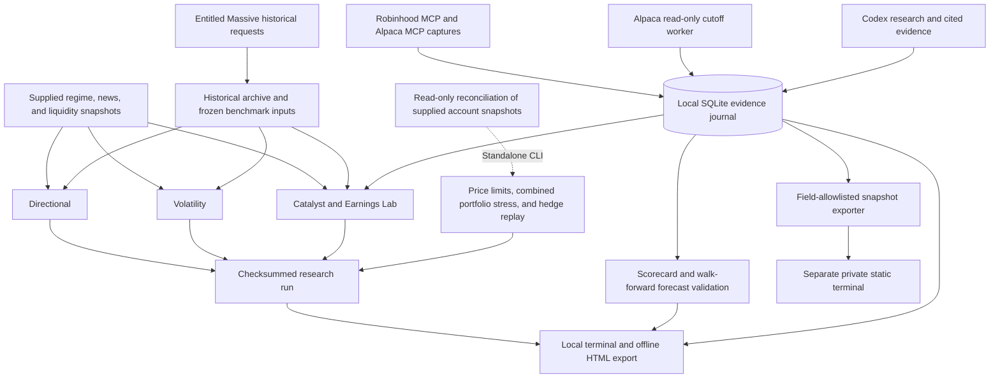

# Rook Options Desk system review for Neon

**System state recorded November 27, 2026**

Rook is a solo-operated options research desk for finding aggressive, repeatable opportunities with bounded exposure. Its current product is a local research terminal backed by a point-in-time evidence journal. It can test a thesis, model entry and exit economics, stress a proposed position, and score recorded paper outcomes. The recorded run contains historical research across all three engines and zero eligible prospective phases. Rook is ready for a review of its research and measurement process. An executable edge and live capital readiness remain open questions.

## Objective and design constraints

The objective is to compound capital by selecting opportunities with positive expected P&L after realistic execution costs and with losses that fit both the trade and the combined book. A candidate should specify what the market is pricing, what evidence supports a different distribution, the precise contract and decision time, the fill assumptions, and what invalidates the thesis. Cash is a valid outcome. Contract granularity matters for a small account. A setup can be interesting while even one contract is too expensive or exposes the account to too much correlated risk.

Codex supports research, implementation, and cited analysis. Deterministic code selects eligible observations, prices scenarios, and produces research decisions. Today the application has no order submission, cancellation, broker account polling, or automatic capital allocation. The existing capture worker makes read-only market-data requests. The system uses Python 3.11+, SQLite, JSON and CSV artifacts, and a dependency-light HTML/CSS/JavaScript terminal. This permits one operator to replay and inspect the workflow locally.

## Current architecture



The dotted line denotes a separate research control. Broker reconciliation currently returns a CLI report and does not feed the combined risk evaluator. The regime and news snapshot provides common context for all engines. It does not automatically change their frozen benchmark signals. The private static terminal serves an explicitly selected subset of the local journal after export and deployment.

| Layer | Current implementation |
|---|---|
| Market data | `providers.py` normalizes on-demand Robinhood and Alpaca connector responses, including contract identity, quote time, receipt, source, and feed. Alpaca indicative options data is reference-only. Undated Robinhood open interest stays distinct from dated open-interest records. |
| Timed capture and archive | `capture.py` supports a registered Alpaca OPRA plus SIP/IEX cutoff workflow with authorized credentials. It records capture failures as well as successes and verifies standard deliverables for live capture. Robinhood-registered protocols use connector imports at their cutoffs. Historical Massive retrieval requires suitable entitlements and runs on a separate replay path. |
| System of record | `optionsdesk.py` owns the SQLite journal. Captures are idempotent. Frozen decisions carry their inputs, selected evidence, version, and SHA-256 digest. Replay verifies the digest and recomputes under the original pricing rules. Research-run integrity checks include SQLite health and decision replay. These local hashes detect discrepancies during replay. The database remains under the local operator’s control. |
| Market intake | `market_scan.py` assesses SPY trend versus 20- and 50-session averages, realized-volatility rank, and five-ETF breadth. It timestamps and deduplicates news, distinguishes primary releases from leads, and checks option quote age, spread, size, and supplied broker cutoff. Incomplete breadth can leave the regime unclassified. The intake consumes supplied snapshots. |
| Research and review | `desk_engines.py` runs independent Directional, Volatility, and Catalyst studies. `frontier.py` records a cited review and can compare explicitly supplied probability distributions against the same frozen payoff. `research_graph.py` stores typed claims and exact citation spans with source, extractor, availability, and validity. Future-known and superseded information is filtered at query time. Model claims cannot supersede human evidence. |
| Risk and decision research | `market_risk.py`, `advanced_risk.py`, `price_limits.py`, `candidate_review.py`, and `hedge_replay.py` provide payoff, repricing, liquidity, loss-bound, and stress tools. Most operate on explicit JSON cases and return reproducible results. `broker_reconcile.py` compares normalized, timestamped cash, position, and single-instrument working-order snapshots. Feed access, snapshot completeness, and operating authority sit outside that comparison. |
| Measurement | `earnings.py`, `scorecard.py`, and `forecast.py` register decisions, preserve passes and missed windows, resolve quote replays, record paper outcomes, and separate signal calibration from implementation results. `desk_run.py` recomputes the saved benchmarks, runs synthetic controls, hashes the inputs, and writes the local research run. |
| Presentation and publication | `dashboard.py` serves a loopback view or exports a standalone local HTML file. `publish_snapshot.py` exports a versioned static read model with selected decision IDs, scenario summaries, and reviewed excerpts. The separate hosted checkout consumes this projection. The projection excludes raw broker payloads, quote-level evidence, account state, the full journal, and credentials. |

## How research moves through the desk

1. **Capture and freeze the decision time.** A journal observation is eligible only if its market time and its receipt time fall at or before the decision cutoff. Freshness, source/feed, quote sides, and leg synchronization are independent checks. Where available, confirm the exact contract, deliverable, expiry time, and calendar. News and event evidence have separate publication, first-seen, and journal times.
2. **Choose a benchmark.** Freeze the universe, candidate rule, outcome window, investment constraints, and comparison before observing outcomes. An earnings study compares outright option, same-expiry debit spread, underlying, and cash using the same illustrative entry budget. The prospective lab stores pre- and post-release records separately and checks the time of the actual release for the latter.
3. **Price the expression.** The decision journal’s original instrument is a standard equity call debit spread. Catalyst and other research tools also support calls and puts. Synthetic leg marks cross displayed quotes, and displayed size is an execution constraint in quote replay. A vertical’s synthetic mark cannot establish the package price. The price-limit evaluator requires baseline and adverse-selection distributions for each tested price, with assumptions available by the cutoff.
4. **Check joint risk.** Candidate review verifies that price assumptions and portfolio legs agree on strike, right, quantity, fees, and expiry. It applies the available loss budget and adds the proposed trade to the supplied book before full stress repricing. It also accounts for entry cost above model mark. A passing entry price can still produce a pass on the candidate.
5. **Score the outcome.** A quote replay, synthetic scenario, and observed paper record have separate bases. The scorecard retains no-fills, partial fills, missing prices, eligible attempt counts, and paper slippage. Coverage and paired comparisons are explicit. Paper option markouts use fresh point-in-time quotes at 1, 5, 10, and 60 seconds and five minutes for positions still open. Spread markouts use leg midpoints.
6. **Review new claims.** A research proposal can tie a hypothesis to original source text and an economic rationale. Deterministic checks enforce cited span and timing rules. Semantic accuracy and evidence that the feature adds predictive value are separate reviews.

## The three engines

| Engine | Working baseline | Test worth considering |
|---|---|---|
| **Directional** | Relative strength versus QQQ on regular-session closes. Screener audits recompute stock breakeven touches and separately check exact-contract broker snapshots and hypothetical bid-side P&L where available. | Use a point-in-time universe and compare a simple tape/relative-strength control with risk-adjusted trend or verified flow features. Measure lift on executable option outcomes, grouped by common market dates. |
| **Volatility** | Daily-close variance challengers compare a 20-session mean, EWMA, and a fixed power-law filter. The surface reports bid, mid, and ask IV and strike and calendar diagnostics. Portfolio scenarios use BSM repricing and IV shifts. | Obtain a timestamped intraday sample with an explicit overnight component. Evaluate HAR-RV, then compare any rough-vol or probabilistic challenger on calibration, QLIKE, and execution-adjusted decisions. Benchmark any surface fit against quote bands and static-arbitrage checks. |
| **Catalyst** | Stores timestamped earnings, macro, corporate, regulatory, and other event types. Earnings Lab is the implemented prospective experiment workflow. It compares pure stock direction with trade expressions and supports a three-node event-variance diagnostic. | Keep earnings as one sleeve. Test one independently selected macro release with frozen definitions, a known-by clock, and a matched option measurement window. Assess a cross-venue event prior only after defining the release outcome and estimating its conditional effect on market returns. |

### Volatility and portfolio math

The Greek report includes delta, gamma, theta, vega, vanna, charm, volga, speed, color, and zomma. Verify units before summing across instruments. Vega and related IV sensitivities use percentage-point shocks, and theta and related time sensitivities use calendar days. Local sensitivities describe nearby moves. Full scenario repricing handles joint shocks and supports per-position IV shifts. Spot, IV, and time attribution averages marginal changes across all six application orders before modeled exit costs. Gross assignment obligations are a separate diagnostic. The current European-style option model is an approximation for American contracts.

The price-limit evaluator estimates expected net P&L per attempt, modeled fill probability, and expected shortfall conditional on a fill. It uses input distributions, assumes fills pay the tested limit, and exposes rejection reasons. Its conditional expected shortfall and the portfolio’s joint scenario loss are distinct quantities. A portfolio expected-shortfall number would require a calibrated portfolio loss distribution.

Hedge replay compares the same option path unhedged, with quote-by-quote delta targeting, and with a fixed no-trade band. A hedge gets the first eligible quote observed after the decision and configured latency. It crosses the spread, pays per-share costs, and uses displayed size. A residual hedge that cannot be liquidated makes terminal P&L unavailable. The fixture assumes a single European cash-settled option, a 100-unit multiplier, and a same-scale whole-share hedge. It omits market impact, queue position, stock borrow, financing, and hedge dividends. Fixed bands currently provide a simple baseline for cost-aware hedging.

## Evidence available for the review

The combined local run at 17:02 UTC on November 27, 2026 passed journal integrity and replayed two decisions. It contained 134 market observations, two unique registered earnings events, one frozen catalyst study, nine scheduled cutoffs, zero eligible prospective phases, and zero scored post-release forecasts. The earliest listed cutoff required a connector import. A fresh test run passed 105 tests. The tests cover mechanics, replay, timing, and coverage. They do not measure alpha.

| Evidence | Observed result | What it establishes |
|---|---|---|
| General directional study | 191/360 correct symbol-window predictions versus 189/360 for always outperform. There were 45 distinct windows. | The simple signal adds two correct outcomes on this sample. Symbols share dates. Option P&L and independent validation remain unmeasured. |
| Earnings direction | 17/30 correct across 23 event days versus 18/30 for always down or flat. Balanced accuracy was 61.1% versus 50%. | Sensitivity to up and down days looks more promising than raw accuracy on this retrospective set. |
| Earnings option overlay | Six matched cases from eight. Signal-or-cash P&L was −$5,190 for outright options and −$4,443 for debit spreads. Both also lost money in the always-on comparison. | The reused closing-quote proxy shows a losing sample. It supplies no matched live fills or untouched holdout. |
| Flow screener audit | 200 rows, 31 stock breakeven touches, 41 option quote snapshots. | Counts are row-based. A stock touching a strike-plus/minus-premium level does not establish that an option could be sold at a profit. |
| Volatility benchmark | Across 37 distinct windows, mean QLIKE was −6.10284 for the power-law filter and −6.09415 for EWMA. Lower is better. | A small development-sample improvement on a daily-close variance proxy. The panel has 333 symbol-windows sharing the same dates. |
| Synthetic decision controls | The price grid had a highest passing tested limit of $1.20. The separate combined candidate fixture declined its candidate because stress exceeded its budget. | The checks can distinguish a modeled entry opportunity from acceptable combined exposure. |
| Synthetic hedge controls | A fixed 12-share band lowered friction to $13.36 from $20.08 under quote-by-quote delta rebalancing. Unhedged P&L was −$6.65, band P&L was −$47.63, and quote-by-quote P&L was −$70.55. | The fixture shows how lower turnover reduces modeled costs. Its settlement ranking applies to one invented path. |

The regularized earnings forecast compares a smoothed event base rate with ridge logistic regression. It trains only on earlier event days with outcomes already available by the test cutoff and separates the pre- and post-release phases. Tests distinguish calibration, label availability, and paper execution. The current training and scoring minimums of 20 training days and 10 test days are implementation floors. They do not establish power for comparing variants or sizing capital.

## Gaps ranked for review

1. **Prospective evidence and data reliability.** The next highest-value work is completing the registered quote capture and outcome loop. Track expected, received, timely, usable, and matched samples separately. Instrument paper markout coverage and record missing data even when a candidate never fills. Verify contract eligibility and the session calendar before each cutoff.
2. **Independent experimentation.** Record all hypothesis variants and their data access history. Separate selection windows from untouched evaluation windows, account for overlapping labels and shared event days, and report uncertainty with cost stress. A concrete goal is a reproducible report that rejects a known leaky feature and a deliberately overfit challenger while allowing a valid comparison to be measured.
3. **Execution evidence.** The current price distributions are supplied, and top-of-book snapshots do not establish queue position, package liquidity, or passive fills. A small, predeclared sample of liquid contracts with timestamped quotes and observed paper attempts is more informative than expanding the symbol universe. Measure side, size, time to expiry, spread, markout, fill rate, and exit cost.
4. **Position lifecycle and tail risk.** The reconciler needs independently sourced complete snapshots, delayed-event handling, and explicit coverage for partial fills, exercise, assignment, liquidations, and corporate actions before it can inform operational controls. Define session- and product-specific handling for expiry, early closes, physical settlement, adjusted deliverables, dividend exposure, and pin risk. Keep probabilistic portfolio tail loss, deterministic crash loss, buying-power stress, and settlement cash separate.
5. **Model and infrastructure cost.** Put a simple baseline beside every expensive model, vendor, or runtime change. Tie an upgrade to a measured coverage gap, latency bottleneck, or demonstrated incremental value on the same evaluation. A faster runtime cannot resolve a missing receipt timestamp, and a more accurate IV fit must still improve a decision after costs.

## Reproduce the review locally

These commands run from the desk project. The hedge, price, portfolio, and candidate fixtures are synthetic.

```sh
python3 -m unittest discover -q
python3 desk_run.py
python3 optionsdesk.py capture-status
python3 optionsdesk.py scorecard
python3 optionsdesk.py forecast-validate --phase post --target stock_up
python3 optionsdesk.py price-limits examples/price-limits.json
python3 optionsdesk.py portfolio-stress examples/advanced-risk.json
python3 optionsdesk.py candidate-review examples/candidate-review.json
python3 optionsdesk.py hedge-replay examples/hedge-replay.json
python3 dashboard.py --export data/terminal.html
```

Project references are `README.md` for input contracts and workflows, `RESEARCH.md` for methods and sources, `data/research-run.json` for the recorded current run, and the companion site's `ARCHITECTURE.md` for the static publication boundary. This packet carries the summarized evidence needed for an external review.

## Request for Neon

Review this as a system design and pre-mortem for one operator. Optimize for the shortest path to credible, repeatable net edge under realistic execution and a small-account risk budget.

1. **Rank the five changes you would implement first.** Give each change its expected effect, build cost, data dependency, failure mode, and quantitative acceptance test. Identify the Rook module it would change.
2. **Find the most dangerous assumptions.** Walk through point-in-time leakage, adverse selection, book and broker divergence, correlation spikes, missing exits, and expiration or assignment. Include one concrete failure sequence and the evidence needed for a deterministic veto or abstention.
3. **Specify one lean experiment per engine.** Give the hypothesis, benchmark, observation cutoff, holdout and overlap treatment, fill and fee model, primary metric, data requirement, and explicit stop rule. Include at least one design that can be run on a small liquid universe.
4. **Design the research-to-paper promotion gate.** Specify how it records failed trials, handles multiple testing, compares execution on common opportunities, and reports clustered uncertainty. Define what would earn a second evaluation and what would retire the idea.
5. **Recommend one frontier intelligence feature with a fair baseline and an ablation.** Choose among event evidence extraction, a calibrated distributional volatility forecast, flow classification, or another idea with an economic rationale. Explain which decision it could improve and what incremental measured result would justify the work.
6. **Return a prioritized 30-day build plan.** Separate fixes possible with existing data from work requiring verified entitlements or broker access. Flag assumptions explicitly and source any statement about current broker behavior, market-data terms, or regulation. Treat capabilities outside this packet as unverified.
